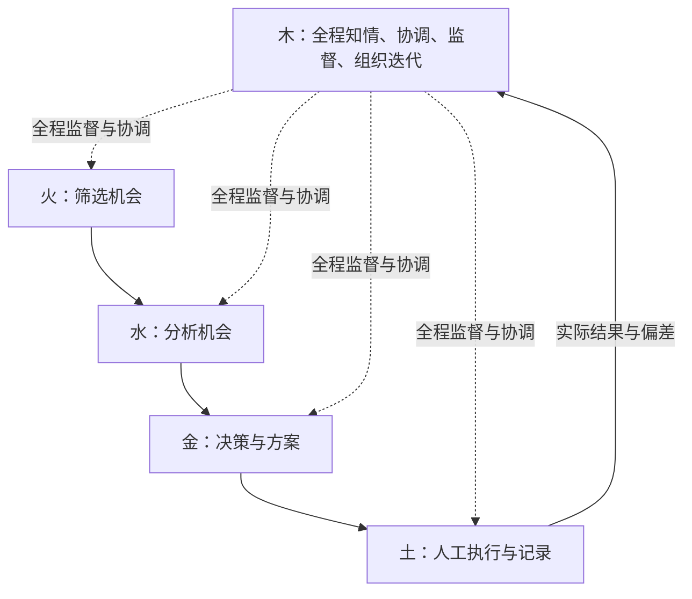

# 五行交易团队职责框架

2026年10月4日｜按五简本次明确的分工整理。

**火、水、金、土负责各自的专业工作；木全程知情，负责协调、监督和组织迭代。** 所有人理解同一套框架，接受自己的职责和约束，再聚焦做好本职工作。

职责方向以本次本人说明为依据；下列交接表达是落地建议。本文不改变既有交易方向、风险比例、入场规则或真实账户权限，也不表示程序和人员已经实现这些职责。

## 一、整个系统怎样运转

业务主线是：**火筛选机会 → 水分析机会 → 金形成并确认交易方案 → 土人工执行与记录。**

木从选图开始持续获得信息，在各环节监督和协调；新增风险进入执行前由木复核。执行的实际结果和偏差再回到木，由木组织相应岗位复盘与改进。木贯穿全程，不是业务主线末尾才出现的一道工序。

图中的业务箭头表示交接关系，不豁免执行前的风控复核。常规研究和记录在各自权限内推进；已约定的止损与紧急保护不等待AI重新批准。

## 二、五个角色各自负责什么

| 角色 | 必须回答的问题 | 本职工作与交付 | 权限边界 |
|---|---|---|---|
| 火：机会筛选 | 哪些环境符合标准，值得继续看？ | 按既定选图、择境规则筛选；交出候选、方向、行情日期、依据和不确定项 | 候选只是观察资格；不代替水的研究、金的交易决定 |
| 水：机会分析 | 支持与反对这个机会的证据是什么？ | 分析事实、机制、竞争解释、反证及缺口；交出研究结论、来源和重新评估条件 | 可以提出等待或撤回假说；不以基本面信心放宽交易与风险规则 |
| 金：交易决策 | 做、等还是放弃；若参与，具体怎样安排？ | 综合上游材料和账户条件，在授权范围内确定入场、退出、止损、仓位及计划有效条件；交出事前明确的方案 | 对方案选择负责；必须接受木的规则与权限复核，不得临场扩大授权 |
| 土：执行落实 | 实际动作是否符合有效计划？ | 核对执行条件，由人工实施下单与调整；保存真实委托、成交、保护状态、费用和异常 | 按已确认且通过复核的有效计划行动；不擅改手数、止损、方向或交易理由 |
| 木：协调与监督 | 各岗位是否在框架内履职，信息是否接上，问题是否处理完？ | 全程知情；核对规则、账户风险和权限；协调交接与分歧；跟踪异常；组织复盘和迭代 | 不具体选机会、写产业分析、决定买卖或下单；不能私自放宽框架，也不能代替岗位负责人承担其专业判断 |

五行是五类职责，不自动等于五名员工或五个独立AI。有人兼任时写清当前角色；同一人做了决定又复核自己，应明确为自审。

## 三、木的职责展开

**全程知情。** 木能够查看每一笔交易的候选、研究、计划、账户风险、执行和复盘记录。关键判断改变、证据失效、执行异常或交接中断，要同步给木，不能只交最后结果。知情并不免除原岗位的责任。

**协调交接。** 木知道事情到了哪一步、谁正在负责、下一个岗位缺什么。信息不全时，让提供者补充；接收者没看懂时，组织澄清；没有人承接时，明确负责人。沿用同一轮次的卡片和附件，不要求五个岗位重复写五套相同资料。

**监督框架。** 木检查火是否按选图标准筛选、水是否把事实与推断分开、金是否在风险和权限内形成方案、土是否按有效方案执行。发现不符合规则或缺少必要条件时，可以要求退回、纠正，依既定规则拒绝放行或停止新增风险。理由应指向具体规则或证据缺口，不能仅凭木个人看多看空。

**协调团队关系。** 意见不同，先区分是事实不一致、专业判断不同、规则有歧义，还是执行偏离。木组织相关角色说明依据，明确下一步和责任；不为维持表面一致而压下异议，也不要求所有专业判断都服从木个人的观点。

**组织迭代。** 木收集反复出现的问题、安排复盘、跟踪改进是否被落实。具体方法由相应岗位提出并完善：火改筛选，水改研究，金改方案形成，土改执行。木可以指出流程和衔接问题、提出改进建议，但不接管他们的日常专业工作。

**跟踪迭代效果。** 修改不是写完新文档就结束。木保留原问题、修改理由、验证结果和仍未解决的部分；证据不支持改善时，组织重审。木自己造成重复审批、信息阻塞或责任不清，也纳入复盘。

## 四、金与木怎样配合

金判断一笔机会是否值得参与，木核对这个判断是否形成于既定框架之内。木复核通过，只表示其负责检查的条件满足，不保证交易会盈利。

例如，金提出一份计划，木发现仓位超过当前允许范围，应指出超出的依据并退回金重做；木不自行换一个品种、改成另一方向或替金选买点。

如果只是水与金对行情前景看法不同，木先把证据、分歧和适用规则摆清楚。金仍在自己的授权范围内作交易选择；若分歧触及硬性条件或框架本身尚未定义，不能靠木或金的个人信心补许可，应提出具体冲突供框架层判断。

已发生的偏差由土如实记录、木组织核对与处置，不能删除不合规成交来美化结果。是否获准与实际发生了什么分别说明。

## 五、每个人先共同理解什么

团队成员加入时，应理解交易目标、基本方法、角色衔接、必须遵守的边界，以及何时报告问题。他不必精通所有岗位，但要明白自己的输出会影响谁，不能把未完成的判断交给下游猜。

共同遵守现行顺势纪律、止损与以损定量规则；收益目标不能成为越权理由。任何角色发现问题，都应及时告知木和相关岗位，不能用“不是我的职责”隐瞒已看到的错误。

看岗位是否做好，要看它可负责的过程：火的候选是否符合标准，水的证据是否扎实，金的方案是否清楚且在授权内，土是否如实执行，木是否发现并推动解决问题。团队收益仍须完整记录检验，不能用某一笔盈亏给所有岗位一并下结论。

## 六、五简与框架变更

你负责系统方向、角色授权和重大框架调整的判断。你长期希望承担的系统运营监督，与木的职责相吻合；这是岗位目标，实际接班和权限移交仍看记录。

现阶段你若亲自担任金，就按金的权限决策，接受木监督。你以框架负责人身份处理变更时，要与某笔交易的金确认分开：写清改什么、依据是什么、怎样验证、何时生效，按既定变更程序处理，不能为眼前超额交易临时开口子。

## 七、细节按证据逐步优化

保持这条简短的改进顺序：**出现具体问题 → 相关岗位拿出材料和原判断 → 木协调核对与提出改进议题 → 框架负责人处理需要变更的事项 → 原岗位验证和落实 → 木跟踪结果。**

运用你说的贝叶斯迭代思维：保留原判断，说明什么新证据让判断增强或减弱；区分正常结果波动、分析错误、执行偏差和规则缺口；证据不足就保留未知，不强行编一个概率，也不因一笔盈亏重写整个系统。

框架以内的常规工作，各角色按现行授权完成；影响正式方法、风险标准和权限的变化，回到原有变更程序。木组织学习和改进，不能单方面让新规则生效。

当前只保留三处待细化的问题：

- **选图口径：**现有月周观察与小木月周日共振的范围、版本不同，每次先说明用哪套，不静默混用。
- **入场名称：**“反K回调／反K收线”“情绪单边／清晰单边”的具体触发仍需对照，不能只靠名称视为同一种动作。
- **木的实际能力：**全程职责已经明确，但信息接入、独立复核和各入口拦截还需落实；前一轮发现的问题仍保留，不因职责写清楚而视为已修复。

详细现状见[实际核对报告](2026-10-04_五行闭环实际核对/00_核对报告.md)。已有[账户与团队运行表](../账户与规则/2026-09-27_账户与团队运行表_当前_v1.0.md)和[验证与迭代协议](../账户与规则/2026-09-27_验证与迭代协议_当前_v1.0.md)继续承载具体记录；本次不重建一套日常表单。

本次梳理依据：五简2026年10月4日本轮对木的直接说明、此前确认的金权限边界，以及上述现有资料。职责方向已按本人说明整理；岗位表现、程序能力和交易效果没有因此升级为已验证。
